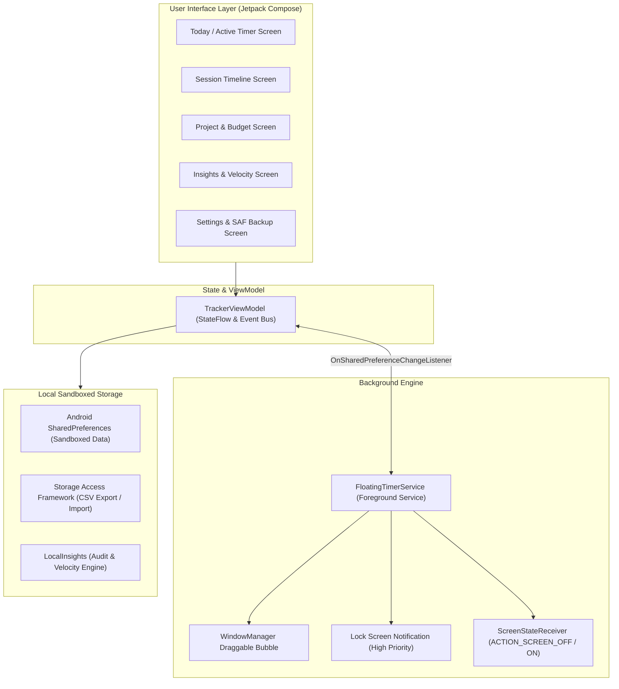

# WatchaWatch

<p align="center">
  
</p>

<p align="center">
  <strong>Native, Air-Gapped Precision Time Tracker & Productivity Chronometer for Android</strong>
</p>

<p align="center">
  <a href="#features"></a>
  <a href="#specifications"></a>
  <a href="#architecture"></a>
  <a href="#architecture"></a>
  <a href="#privacy--security"></a>
  <a href="#privacy--security"></a>
</p>

---

## Executive Summary

**WatchaWatch** is a native Android time tracking and productivity management chronometer built from the ground up using **Kotlin**, **Jetpack Compose**, and **Material 3**. Engineered for professionals, engineers, and privacy-conscious users, WatchaWatch combines the refined aesthetics of luxury horology with an uncompromising zero-telemetry, air-gapped architecture.

Unlike cloud-dependent tracking platforms, WatchaWatch never requests `android.permission.INTERNET`. Every session, task, project budget, receipt attachment, and financial computation is processed and retained exclusively within the device's local application sandbox.

---

## Key Features

### ⏱️ Persistent Multi-Mode Focus Timer
- **Drift-Free Monotonic Timing**: Derives duration strictly from epoch timestamps rather than battery-draining polling loops.
- **Resilient Background Execution**: Managed by `FloatingTimerService` with `START_STICKY` resilience and `foregroundServiceType="specialUse"`, preventing Android OS Doze kills.
- **Screen-Off Persistence**: Dedicated broadcast receiver and low-power `WakeLock` manage state transitions seamlessly across device lock and unlock cycles.

### 🫧 Picture-in-Picture Floating Timer Bubble
- **System Window Overlay**: Minimized active sessions transition into an interactive, draggable floating clock bubble (`TYPE_APPLICATION_OVERLAY`).
- **Drag-to-Dismiss & Quick Close**: Intuitive gesture physics allow flinging or dragging the bubble into a dismiss target zone, or tapping the dedicated close button.
- **Smart Foreground Invalidation**: The bubble automatically conceals itself whenever the primary app interface returns to the foreground, eliminating screen clutter.

### 🔒 Interactive Lock Screen Notification
- **Always-Visible Priority**: Channels ongoing high-priority notifications with public lock screen visibility, keeping active tasks, project identifiers, and running times immediately accessible.
- **Zero-Latency Actions**: Direct Pause, Resume, and Finish buttons operate straight from the lock screen without requiring device unlocking or heavyweight activity launches.

### 📊 Session Timeline & Resumption Tracking
- **Dual Analytical Views**:
  - **Daily Aggregation**: Summarizes cumulative hours, billable totals, and session counts across individual calendar days.
  - **Activity Timeline**: Groups related continuous sessions, highlighting pause intervals and tracking resumption continuity.
- **Precision Typography**: Displays time formatted in exact hours, minutes, and seconds (`Hh Mm Ss`).

### 💼 Project Management, Budgets & Financials
- **Color-Coded Taxonomy**: Organize work streams into distinct, customizable projects.
- **Cost & Billable Rate Tracking**: Independent labor costs and client billing rates per project, supporting diverse international currencies.
- **Time Budgets & Retainers**: Configure ceiling limits with proactive threshold warnings.
- **Documented Receipts**: Attach physical expense receipt photos using Android's native Storage Access Framework (SAF).

### 🔍 Local Integrity Audit & Predictive Velocity
- **Deterministic Anomaly Detection**: Proactively flags missing task descriptions, unassigned projects, and abnormal sessions exceeding 12 consecutive hours.
- **7-Day Velocity Burn-Down**: Automatically projects project completion timelines and budget exhaustion dates using trailing seven-day moving averages.

### 🎨 Luxury Horology Visual Identity
- **Master Chronometer Aesthetics**: Features a bespoke royal indigo and gold chronometer BrandMark with precision concentric dial geometry and golden hands.
- **SSAA Multi-Density Launcher Assets**: Adaptive icons generated from SVG vectors downsampled with 4x Super-Sampled Anti-Aliasing across MDPI, HDPI, XHDPI, XXHDPI, and XXXHDPI densities.

---

## Architectural Overview



For complete technical specifications, see [docs/ARCHITECTURE.md](docs/ARCHITECTURE.md).

---

## Codebase Organization

```
watchawatch/
├── app/
│   ├── build.gradle.kts           # Gradle module build configuration
│   └── src/
│       ├── main/
│       │   ├── AndroidManifest.xml # Hardened manifest (targetSdk 34, zero-internet)
│       │   ├── java/com/watchawatch/app/
│       │   │   ├── MainActivity.kt        # Compose UI screens, navigation & ViewModel
│       │   │   ├── FloatingTimerService.kt # Foreground service, overlay & notifications
│       │   │   ├── SessionTimeline.kt     # Timeline aggregation & grouping logic
│       │   │   ├── LocalInsights.kt       # Local audit engine & velocity forecasting
│       │   │   ├── CsvTransfer.kt         # RFC-4180 CSV import/export pipeline
│       │   │   └── Models.kt              # Domain entities (TimeEntry, Project, etc.)
│       │   └── res/                       # Vector drawables, mipmaps, XML configurations
│       └── test/java/com/watchawatch/app/
│           ├── SessionTimelineTest.kt     # Timeline grouping & formatting unit tests
│           ├── LocalInsightsTest.kt       # Anomaly audit & velocity forecast unit tests
│           └── CsvTransferTest.kt         # CSV serialization & parsing tests
├── docs/
│   ├── ARCHITECTURE.md            # Deep technical architecture & lifecycle docs
│   └── BUILD_AND_TEST.md          # Comprehensive build, toolchain & testing guide
├── scripts/
│   ├── build_modules.py           # Autonomous low-memory Kotlin compiler pipeline
│   ├── package_apk.py             # Packaging, dexing, alignment & release signing
│   ├── generate_app_icons.py      # SSAA multi-density icon generation pipeline
│   └── send_apk.py                # Artifact distribution utility
├── tests/
│   └── verify_watchawatch.py      # Full 5-stage automated verification suite
├── build.gradle.kts               # Root build script
├── settings.gradle.kts            # Root project settings
└── README.md                      # Primary project documentation
```

---

## Building and Verification

### Standard Gradle Build
```bash
# Assemble Release APK
./gradlew assembleRelease

# Execute Local Unit Tests
./gradlew testReleaseUnitTest
```

### Standalone Low-Memory Toolchain (Headless / VM)
For environments where memory constraints prevent running full Gradle daemons:
```bash
# 1. Compile all Kotlin modules to bytecode
python3 scripts/build_modules.py

# 2. Package, desugar (d8), align, and sign release APK
python3 scripts/package_apk.py
```

### Automated Verification Suite
Run the comprehensive 5-stage automated compliance and unit test verification:
```bash
python3 tests/verify_watchawatch.py
```
```
=================================================================
     WatchaWatch Automated Verification & Compliance Suite
=================================================================
[1/5] Checking AndroidManifest security and permissions...
  ✓ PASS: Zero-internet air-gapped security confirmed.
  ✓ PASS: POST_NOTIFICATIONS, WAKE_LOCK, and FOREGROUND_SERVICE_SPECIAL_USE verified.
[2/5] Checking FloatingTimerService lifecycle & lock screen notification architecture...
  ✓ PASS: START_STICKY lifecycle resilience verified.
  ✓ PASS: Lock screen persistent notification with active project tracking verified.
  ✓ PASS: Screen-off/wake broadcast receiver and WakeLock management verified.
  ✓ PASS: Persistent bubble coordinates and FLAG_SHOW_WHEN_LOCKED verified.
[3/5] Checking MainActivity and State Synchronization...
  ✓ PASS: ViewModel SharedPreferences change listener verified.
  ✓ PASS: POST_NOTIFICATIONS runtime permission prompt verified.
  ✓ PASS: Foreground service auto-start for active timer verified.
  ✓ PASS: SessionsPage dual-mode timeline navigation verified.
[4/5] Compiling and running unit tests via JUnit Core...
  ✓ PASS: All unit tests (including SessionTimelineTest) passed successfully.
[5/5] Compiling FloatingTimerService.kt with Android SDK...
  ✓ PASS: FloatingTimerService compiled cleanly with zero errors.
=================================================================
  ALL 5 VERIFICATION SUITES PASSED (100% SUCCESS)
=================================================================
```

For detailed build instructions, see [docs/BUILD_AND_TEST.md](docs/BUILD_AND_TEST.md).

---

## Technical Specifications

| Parameter | Specification |
|---|---|
| **Language** | Kotlin 2.3.0 |
| **UI Framework** | Jetpack Compose (Compiler 1.5.15) with Material 3 |
| **Minimum SDK** | Android 8.0 Oreo (API Level 26) |
| **Target SDK** | Android 14 UpsideDownCake (API Level 34) |
| **Compile SDK** | Android 16 (API Level 36) |
| **Packaging & Signing** | Production RSA 2048-bit Key, APK Signature Scheme v2 + v3 |
| **Data Storage** | Sandboxed Android `SharedPreferences` + Storage Access Framework |
| **Network Permissions** | None (`android.permission.INTERNET` omitted) |

---

## Privacy, Security & Play Protect Compliance

- **Zero Network Permitted**: No network permissions are declared in `AndroidManifest.xml`. WatchaWatch physically cannot transmit telemetry, device identifiers, or analytics.
- **Explicit SDK Sandboxing**: Aligned with modern Android 14 (`targetSdkVersion 34`), eliminating legacy implied dangerous permissions (`READ_PHONE_STATE`, external storage fallbacks).
- **Hardened Keystore**: Sideloading builds are cryptographically signed using a dedicated production RSA release certificate, avoiding debug keystore heuristic warnings in Google Play Protect.
- **Privacy by Design**: Fully satisfies EU GDPR Article 25 and German BDSG/TTDSG privacy-by-design standards.

---

## Version History & Changelog

### Version 1.5.2 (Build 152) - 2026-11-11
- **Play Protect Hardening**: Declared explicit `<uses-sdk android:minSdkVersion="26" android:targetSdkVersion="34" />` and passed explicit target SDK flags to `aapt2 link`, eliminating legacy implied permissions.
- **Production Keystore Signing**: Migrated packaging pipeline to a dedicated 2048-bit RSA release keystore with APK Signature Scheme v2 and v3.
- **Automated Verification**: Enforced automated badging assertions for SDK versions and permission isolation.

### Version 1.5.1 (Build 151) - 2026-11-11
- **Launcher Icon Stabilization**: Synchronized stable resource IDs (`stableIds.txt`) between `aapt2 compile` and `aapt2 link`.
- **Explicit Manifest Badging**: Bound `android:icon` and `android:roundIcon` directly to `.MainActivity`, invalidating legacy launcher icon cache.

### Version 1.5.0 (Build 150) - 2026-11-11
- **Luxury Horology Branding**: Designed bespoke royal indigo and gold chronometer BrandMark.
- **SSAA Multi-Density Generation**: Implemented 4x Super-Sampled Anti-Aliasing pipeline generating adaptive launcher icons across MDPI through XXXHDPI densities.

### Version 1.4.0 (Build 140) - 2026-11-10
- **Overlay Refinement**: Added drag-to-dismiss zone and instant close button to floating timer bubble.
- **Smart Foreground Invalidation**: Automatically conceals floating bubble when `MainActivity` is active.
- **Status Bar Iconography**: Added monochrome status bar vector clock drawable.

### Version 1.3.0 (Build 130) - 2026-11-10
- **Duration Precision**: Formatted duration displays into exact hours, minutes, and seconds.
- **Lockscreen Channel Priority**: Upgraded notification channel priority to `PRIORITY_HIGH` with `VISIBILITY_PUBLIC`.

### Version 1.2.0 (Build 120) - 2026-11-10
- **Session Timeline**: Built dual-mode session timeline (Daily Aggregation & Activity Breakdown) with pause and resumption tracking.
- **Headless Toolchain**: Engineered standalone `build_modules.py` and `package_apk.py` for headless low-memory compilation.

### Version 1.0.0 - 2026-11-09
- **Initial Upstream Release**: Core timer tracking, project color coding, CSV export/import, and local audit features.

---

## License

This project is licensed under the Apache License, Version 2.0. See the `LICENSE` file for details.
