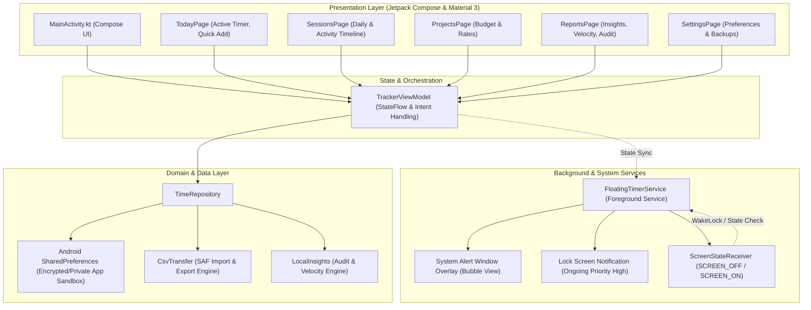

# WatchaWatch Architecture & Technical Specification

## Overview

WatchaWatch is a privacy-first, offline-native Android time tracking application engineered with Kotlin, Jetpack Compose, and Material 3. It operates with **zero network permissions** (`android.permission.INTERNET` is neither requested nor used), ensuring all user records, timer states, and project analytics remain completely private on the physical device.

---

## 1. High-Level Architecture

The application adheres to Clean Architecture principles adapted for modern Android Jetpack Compose development:

---

## 2. Core Subsystems

### 2.1 Persistent Focus Timer & Lifecycle Engine
- **Timestamp-Based Accumulation**: Elapsed duration is computed via monotonic and wall-clock timestamps (`startedAt`, `pausedAt`, `accumulatedDuration`) rather than CPU-bound background ticking loops. This guarantees zero drift and minimal battery consumption.
- **Foreground Service (`FloatingTimerService`)**:
  - Registered as `foregroundServiceType="specialUse"` adhering to Android 14+ (API 34) background execution guidelines.
  - Lifecycle resilience: Runs with `START_STICKY`, automatically recovering if the OS briefly reclaims memory under extreme system pressure.
  - Integrates a `ScreenStateReceiver` that listens for `Intent.ACTION_SCREEN_OFF` and `Intent.ACTION_SCREEN_ON`. Maintains an explicit low-power `WakeLock` to safely persist state transitions without draining the battery.

### 2.2 System Window Overlay (Floating Timer Bubble)
- **Overlay Window Management**:
  - Utilizes `android.view.WindowManager` with `LayoutParams.TYPE_APPLICATION_OVERLAY`.
  - Configured with `FLAG_NOT_FOCUSABLE` and `FLAG_SHOW_WHEN_LOCKED` allowing interaction above other applications and optionally on secure lockscreens.
- **Gesture Physics & Dismissal**:
  - Touch listener handles fluid multi-touch drag gestures across screen edges.
  - Integrated Drag-to-Dismiss target zone and a dedicated close button that hides the overlay while maintaining background timer operation.
  - **Foreground Smart Detection**: The overlay automatically collapses/hides whenever the user brings the primary `MainActivity` into the foreground, avoiding visual clutter.

### 2.3 Lock Screen Persistent Notification
- **Channel Configuration**:
  - Channel: `watchawatch_timer`
  - Priority: `NotificationCompat.PRIORITY_HIGH`
  - Visibility: `NotificationCompat.VISIBILITY_PUBLIC` (displays current project, task name, and elapsed timer on lockscreens).
- **Interactive Action Intents**:
  - Dispatches `PendingIntent` triggers directly into `FloatingTimerService` for instant Pause, Resume, and Finish actions without launching the heavyweight UI activity.

### 2.4 Session Timeline & Resumption Tracking
- **Two Timeline Modes**:
  1. **Daily Aggregated View**: Groups focus sessions by local calendar day, computing net focus duration and session counts.
  2. **Activity Timeline View**: Groups continuous sessions by project and task name, tracking session pauses and continuity resumptions.
- **Precision Formatter**:
  - Accurately renders elapsed time in `Hh Mm Ss` notation, preventing rounding discrepancies.

### 2.5 Local Integrity Audit & Predictive Velocity Engine
- **Deterministic Local Audit**:
  - Identifies anomalies without server telemetry:
    - Missing task descriptions
    - Unassigned project references
    - Improbable sessions exceeding 12 consecutive hours
    - Zero-duration or negative timestamp entries
- **7-Day Velocity Budget Burn-Down**:
  - Analyzes the trailing 7 days of verified local entries to compute project burn rates and forecast remaining days until budget exhaustion.

---

## 3. Security, Privacy & Android 14+ Hardening

| Dimension | Implementation Details |
|---|---|
| **Network Access** | Complete absence of `android.permission.INTERNET`. Zero outgoing connections. |
| **Data Storage** | Sandboxed private application storage (`context.getSharedPreferences`). |
| **External Sharing** | Strictly mediated by Android Storage Access Framework (SAF) and `FileProvider`. |
| **SDK Target** | `minSdkVersion: 26` (Android 8.0 Oreo), `targetSdkVersion: 34` (Android 14 UpsideDownCake). |
| **Package Signatures** | Signed with dedicated 2048-bit RSA production keystore via APK Signature Scheme v2 and v3. |
| **Play Protect** | Fully compliant with Google Play Protect strict sideloading and security criteria. |

---

## 4. State Synchronization Pattern

`TrackerViewModel` and `FloatingTimerService` coordinate via Android `SharedPreferences.OnSharedPreferenceChangeListener`.
When either component updates the active session (e.g., from the notification action or the in-app timer controls), the change listener triggers immediate state reconciliation across both threads.
